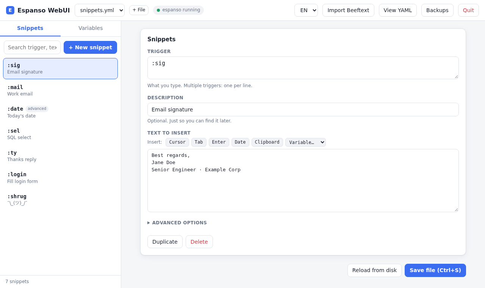

# espanso-webui

🇬🇧 English · 🇧🇷 [Português](README.pt-BR.md)

**A local web GUI for [espanso](https://espanso.org), the cross-platform text expander.**
Create, edit, search and import text-expansion snippets from your browser instead of hand-editing YAML.
Built for Linux (**Wayland and X11**), macOS and Windows — a friendly alternative to
**Beeftext**, TextExpander or AutoKey, with a one-click **Beeftext JSON import**.

<p align="center"></p>

## Why

espanso is a fast, privacy-friendly text expander, but it has no graphical snippet manager — you edit YAML files.
espanso-webui adds a small GUI on top **without adding a background service**: run the command, a page opens in your
browser, press Ctrl+C (or leave it idle for 15 minutes) and everything stops.

- **No daemon, no telemetry, no internet needed.** One Python file + one HTML file. No CDN, no npm.
- **Only needs Python 3.8+ and PyYAML.**
- Create / edit / duplicate / delete snippets, instant search, multiple triggers per snippet.
- Insert-helpers for **cursor position, Tab, Enter, date, clipboard** and your global variables.
- **Global variables** tab — secret values (passwords) are masked until you click the eye.
- **Import from Beeftext** (`.json` export) with a conversion report of anything that has no equivalent.
- **Automatic backups** before every write (`~/.local/share/espanso-webui/backups`, last 30 per file) with restore from the UI.
- **Safe writes:** detects if the file changed on disk, and only writes YAML that was verified by reading it back.
- Light/dark theme (follows your system) and English/Portuguese UI (follows your browser).
- Works the same on X11 and Wayland — it only edits files; espanso does the typing.

## Install & run

```bash
git clone https://github.com/renato-figueiredo/espanso-webui
cd espanso-webui && ./install.sh     # links the command into ~/.local/bin
espanso-webui                        # opens http://127.0.0.1:8765/?t=<token>
```

You can also run it in place with `./espanso-webui`. Requires [espanso](https://espanso.org/install/) to be installed;
PyYAML is packaged as `python3-yaml` (Debian/Ubuntu/Fedora) or `pip install --user pyyaml`.

Options:

| Flag | Meaning |
|---|---|
| `--match-dir DIR` | espanso `match` folder (default: auto-detected via `espanso path config`) |
| `--port N` | preferred port (default `8765`, next free one is used if busy) |
| `--idle MIN` | exit after N idle minutes (`0` = never, default `15`) |
| `--no-browser` | don't open the browser automatically |

## Import from Beeftext

In Beeftext: *File → Export*. In espanso-webui: **Import Beeftext** → pick the `.json` → review the summary → **Add to file** → **Save file**.

| Beeftext | espanso |
|---|---|
| `#{cursor}` | `$\|$` |
| `#{key:tab}` / `#{key:enter}` | `\t` / `\n` with `force_mode: keys` |
| `#{combo:-x}` | variable of `type: match` |
| `#{date}` / `#{time}` / `#{dateTime:fmt}` | variable of `type: date` |
| `#{clipboard}` | variable of `type: clipboard` |
| `#{input:...}` | just the cursor (forms need espanso's *modulo* feature) |

Not migrated: disabled combos are imported as enabled (espanso has no such flag), matching mode / case sensitivity, sounds and Beeftext hotkeys.

## Security & privacy

- Listens on **127.0.0.1 only**, requires a random per-session token (printed in the terminal) and validates the `Host` header — this blocks CSRF and DNS-rebinding from other pages open in your browser.
- Only edits `.yml` files inside the espanso `match` folder (path traversal is rejected).
- Your snippets are never sent anywhere. If you keep passwords in variables they live in plain text in the YAML — don't commit that file to a public repository.

## Limitations

- Saving a file through the UI **drops hand-written YAML comments** (use the *Description* field, which is stored as espanso's `label`). If a file is full of comments, create a new file (**+ File**) instead of editing it.
- Advanced matches (regex, forms, images) are preserved, but only editable as JSON / read-only.
- There is no per-snippet enable/disable switch because espanso has none.

## Development

```bash
python3 -m unittest discover -s tests -v
```

Pull requests are welcome — see the open issues or propose an improvement.

## License

MIT
